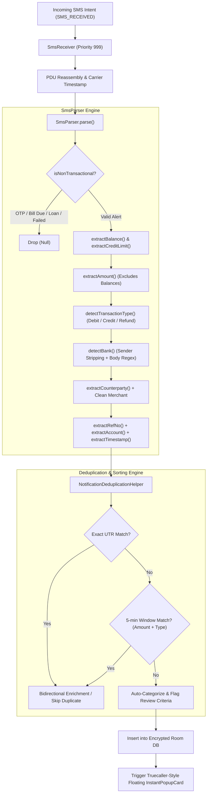
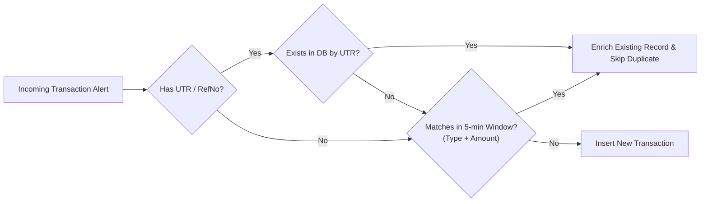

# 🏛️ Kanri SMS Detection, Parsing & Sorting Engine

**Current Version:** 1.9.0 (Build 32)  
**Last Updated:** 2026-11-09  

---

## Overview

Kanri features a fully on-device, zero-telemetry financial transaction engine designed specifically for the Indian banking and UPI ecosystem. The system captures transaction alerts in real time, parses financial entities with high-precision regular expressions, disambiguates account balances from transaction amounts, deduplicates cross-channel alerts (SMS vs. NotificationListener), and triggers an interactive Truecaller-style floating popup (`InstantPopupCard`) for instant one-swipe confirmation.

The engine operates across four primary files:
- `app/src/main/java/com/omkarnub/kanri/receiver/SmsReceiver.kt`: High-priority broadcast receiver and async ingestion pipeline.
- `app/src/main/java/com/omkarnub/kanri/data/parser/SmsParser.kt`: Multi-stage regex extraction, negative filtering, and type resolution.
- `app/src/main/java/com/omkarnub/kanri/data/parser/BankSmsPatterns.kt`: Pattern definitions and sender allowlist across **59 financial institutions**.
- `app/src/main/java/com/omkarnub/kanri/data/parser/NotificationDeduplicationHelper.kt`: Cross-channel sliding window deduplication and bidirectional enrichment.

---

## 1. System Architecture & Detection Lifecycle



### Cold-Start Wakeup & Manifest Registration
In `AndroidManifest.xml`, the receiver is configured with maximum priority (`999`) and protected by the system-level `BROADCAST_SMS` permission. This ensures that the receiver wakes up and executes on-device even if Kanri's application process is closed or killed by OS memory reclamation:
```xml
<receiver
    android:name=".receiver.SmsReceiver"
    android:exported="true"
    android:permission="android.permission.BROADCAST_SMS">
    <intent-filter android:priority="999">
        <action android:name="android.provider.Telephony.SMS_RECEIVED" />
    </intent-filter>
</receiver>
```

### Multi-Part SMS PDU Concatenation
When banking alerts exceed 160 GSM characters (or 70 Unicode characters), cellular networks deliver them as fragmented Protocol Data Units (PDUs). `SmsReceiver` reassembles all segments into a coherent text payload before processing:
```kotlin
val messages = Telephony.Sms.Intents.getMessagesFromIntent(intent)
val sender = messages[0].originatingAddress ?: ""
val fullBody = messages.joinToString("") { it.messageBody ?: "" }
val carrierTimestamp = messages[0].timestampMillis.takeIf { it > 0 } ?: System.currentTimeMillis()
```

### Non-Blocking Asynchronous Persistence
To prevent Android Main thread ANRs (Application Not Responding) when writing to the encrypted SQLCipher Room database, `SmsReceiver` invokes `goAsync()` and offloads the database operation to `CoroutineScope(Dispatchers.IO)`:
```kotlin
val pendingResult = goAsync()
CoroutineScope(Dispatchers.IO).launch {
    try {
        val db = KanriDatabase.getDatabase(context)
        val result = NotificationDeduplicationHelper.processIncomingTransaction(...)
        // Handle insertion, logging, and overlay launch
    } finally {
        pendingResult.finish()
    }
}
```

---

## 2. The Negative Filtering Engine (Rejecting Noise)

Before any entity extraction runs, `SmsParser.isNonTransactional()` validates the SMS against strict negative rules to discard non-financial messages, phishing attempts, and non-completed transactions:

| Category | Filter Patterns Checked | Behavior |
|---|---|---|
| **Failed / Declined Txns** | `declined`, `transaction failed`, `txn failed`, `failed to transfer` (unless accompanied by an active debit) | Dropped |
| **Payment Requests** | `has requested`, `payment request`, `collect request`, `requesting payment`, `requests rs`, `approve payment` | Dropped |
| **Authentication / OTP** | `otp`, `one time password`, `verification code`, `security code`, `login pin`, `do not share with anyone` | Dropped |
| **Credit Card Bill Due Reminders** | `is due`, `bill due`, `payment due`, `min amount due`, `total due`, `pls pay min`, `pay by ... due` | Dropped |
| **Mandates & Subscriptions** | `e-mandate`, `upi-mandate`, `mandate registered`, `mandate created`, `will be debited` | Dropped |
| **Promotions & Loans** | `pre-approved loan`, `apply now`, `win cash`, `cashback offer`, `congratulations! you are eligible` | Dropped |
| **E-Statements** | `e-statement`, `statement of your`, `stmt` (without active debit/credit) | Dropped |
| **Personal Mobile Numbers** | Senders with 10+ digits starting with `+` or digits only | Marked untrusted sender / filtered |

---

## 3. Parsing & Disambiguation Algorithms

### Disambiguating Remaining Balance vs. Spend Amount
A common failure point in SMS parsers occurs when an alert contains both an expense amount and an updated remaining balance:
> *"Your A/c XX8477 debited by Rs. 500.00 on 15Sep26. Avlbl Amt: Rs. 24,500.00"*

In `SmsParser.kt`, the available balance and credit limit are extracted **first**:
```kotlin
val balance = extractBalance(trimmed)
val creditLimit = extractCreditLimit(trimmed)
val amount = extractAmount(trimmed, balance, creditLimit) ?: return null
```
`extractAmount()` gathers all candidate amounts matching currency symbols (`Rs.`, `INR`, `₹`) and explicitly excludes values that match `balance` or `creditLimit`.

### Dual Debit/Credit Disambiguation
UPI alerts often mention both debit and credit verbs:
> *"Your A/c no. XX3948 is debited for Rs 850.00 on 18-09-26 and credited to VPA swiggy@icici"*

`SmsParser.detectTransactionType()` checks whether the debit applies to the **user's account** (`debited from your`, `debited from a/c`, `a/c is debited`, `dr. from a/c`). If both are present, it evaluates user-account ownership and flags the transaction as **DEBIT**.

### Merchant & Counterparty Cleaning Pipeline
Merchant extraction (`SmsParser.cleanCounterparty()`) uses 10+ prioritized regex patterns and multi-pass sanitation:
1. **Bracketed Display Names**: `VPA swiggy@icici (Bundl Technologies)` extracts `Bundl Technologies`.
2. **Prefix Stripping**: Strips `Cr. to `, `Dr. to `, `to VPA `, `Info: UPI/`, `POS/`, `NEFT/`, `IMPS/`.
3. **Trailing Noise Truncation**: Strips trailing patterns like `. Avl Bal Rs 500`, `on 18-09-26`, `Ref no ...`, `at 14:30`.
4. **Legal Suffix Stripping**: Removes corporate legal suffixes: `Pvt Ltd`, `Private Limited`, `LLP`, `Ltd`.
5. **Junk Keyword Validation**: Rejects generic tokens (`"ATM"`, `"UPI"`, `"INR"`, `"Rs"`, `"Bank"`, `"Account"`).

### Carrier Delivery Delay Compensation
`SmsParser.extractTimestamp()` parses the in-text date (`dd-MM-yyyy`, `dd-MMM-yy`, `yyyy:MM:dd`) directly from the message body so SMS alerts delayed by cellular networks retain the exact transaction time rather than the delivery time.

---

## 4. Deduplication & Sorting Pipeline

`NotificationDeduplicationHelper` orchestrates cross-channel deduplication between the SMS broadcast receiver and the active `NotificationListenerService`:



### 1. Exact UTR / RRN Deduplication
When an alert contains an alphanumeric reference number (UPI Ref, UTR, Txn ID, RRN) of 6–25 characters, the system performs an indexed database lookup. An existing match updates missing fields (enrichment) without creating a duplicate.

### 2. The 5-Minute Sliding Window
If both an SMS and a UPI app notification arrive for the same payment within **300,000 ms (5 minutes)** with matching transaction type (`DEBIT`/`CREDIT`) and amount:
- **App Notification First**: Captures the rich merchant display name (e.g. *"Paid to Chaayos"*). Subsequent bank SMS enriches the official bank name, account mask, and UTR.
- **Bank SMS First**: Records the transaction immediately. Subsequent notification enriches the display name.

### 3. Review & Sorting Flags
New transactions are automatically categorized via smart merchant rules (`CategoryDao.findSmartRuleForCounterparty`). Entries are flagged with `needsReview = true` under specific conditions:
- **`isUntrustedSender`**: Sender failed allowlist validation (`"Unverified SMS sender: ..."`).
- **`isMerchantEmptyOrUnknown`**: Counterparty could not be resolved or resolved to generic `"UPI"` / `"Bank Transfer"`.
- **`isCashDepositCredit`**: Inbound credit matching CDM / Cash deposit keywords.
- **`isLowConfidence`**: `sourceType == UNKNOWN` and neither bank nor UTR was detected.

---

## 5. Supported Financial Institutions (59 Total)

Kanri contains built-in pattern definitions and sender allowlists in `BankSmsPatterns.kt` for **59 banks and financial services**:

### 1. Top Public Sector Banks (12)
| Bank Name | Code | Supported Sender Prefixes | Keywords & Signatures |
|---|---|---|---|
| State Bank of India | `SBI` | `SBIPAY`, `SBIINB`, `SBISMS`, `CBSSBI`, `SBIPSG`, `SBIUPI`, `ATMSBI`, `SBIBK`, `SBIDBT` | `STATE BANK OF INDIA`, `YONO`, `SBIPAY`, `-SBI` |
| Bank of Baroda | `BOB` | `BOBTXN`, `BOBSMS`, `BARODA`, `BOBALR` | `BANK OF BARODA`, `BOB BANK`, `-BOB` |
| Punjab National Bank | `PNB` | `PNBSMS`, `PUNJAB`, `PNBTXN` | `PUNJAB NATIONAL BANK`, `PNB` |
| Canara Bank | `CANARA` | `CANBNK`, `CANARAB`, `CANARA`, `CANAR` | `CANARA BANK` |
| Union Bank of India | `UNIONB` | `UNIONB`, `UBISMS`, `UNION`, `UBITXN`, `UBI` | `UNION BANK OF INDIA`, `UBI` |
| Bank of India | `BOI` | `BOISMS`, `BOITXN`, `BOIIND` | `BANK OF INDIA`, `BOI` |
| Indian Bank | `INDIANB` | `INDIANB`, `IDBMS`, `INDALR`, `INDIAB` | `INDIAN BANK` |
| Central Bank of India | `CENTBK` | `CENTBK`, `CBISMS`, `CENTRAL` | `CENTRAL BANK OF INDIA` |
| UCO Bank | `UCOBNK` | `UCOBNK`, `UCOSMS`, `UCOBK` | `UCO BANK` |
| Bank of Maharashtra | `MAHABK` | `MAHABK`, `BOMSMS`, `MAHA` | `BANK OF MAHARASHTRA` |
| Punjab & Sind Bank | `PSBBNK` | `PSBBNK`, `PUNJSB`, `PSBSMS` | `PUNJAB & SIND BANK` |
| Indian Overseas Bank | `IOBCHN` | `IOBCHN`, `IOBSMS`, `IOBBANK`, `IOB` | `INDIAN OVERSEAS BANK`, `IOB` |

### 2. Top Private Sector Banks (19)
| Bank Name | Code | Supported Sender Prefixes |
|---|---|---|
| HDFC Bank | `HDFC` | `HDFCBK`, `HDFCSMS`, `HDFCB`, `HDFCCC` |
| ICICI Bank | `ICICI` | `ICICIB`, `ICICISMS`, `ICICIA`, `ICICIT` |
| Axis Bank | `AXIS` | `AXISBK`, `AXISB`, `AXISMS`, `AXISTX` |
| Kotak Mahindra Bank | `KOTAK` | `KOTAKB`, `KMBALR`, `KMBTXN` |
| IDFC First Bank | `IDFC` | `IDFCFB`, `IDFCB`, `IDFCBN` |
| IndusInd Bank | `INDUS` | `INDBNK`, `INDUSB`, `INDUSI` |
| Yes Bank | `YESBNK` | `YESBNK`, `YESB`, `YESBANK`, `YESPAY` |
| Federal Bank | `FEDBNK` | `FEDBNK`, `FEDERAL`, `FEDPAY` |
| RBL Bank | `RBLBNK` | `RBLBNK`, `RBLCRD`, `RATNAK`, `RBLPAY` |
| IDBI Bank | `IDBIBK` | `IDBIBK`, `IDBISMS` |
| South Indian Bank | `SIBLTD` | `SIBLTD`, `SIBBNK`, `SIBSMS` |
| Bandhan Bank | `BANDHN` | `BNDHAN`, `BANDHN`, `BANDHAN` |
| City Union Bank | `CUBBNK` | `CUBBNK`, `CUBTXN`, `CITYUB` |
| Karur Vysya Bank | `KVBANK` | `KVBANK`, `KVBSMS`, `KVB` |
| Karnataka Bank | `KBLBNK` | `KBLBNK`, `KTKBNK`, `KBLSMS` |
| Standard Chartered Bank | `SCBANK` | `SCBANK`, `SCISMS`, `STANBK`, `SCB` |
| HSBC Bank | `HSBCBK` | `HSBCBK`, `HSBCIN`, `HSBC` |
| Citi Bank | `CITIBK` | `CITIBK`, `CITISMS` |
| DBS Bank | `DBSBNK` | `DBSBNK`, `DBSIN`, `DIGIBANK` |

### 3. Small Finance & Neo-Banks (8)
- **AU Small Finance Bank** (`AUBANK`, `AUFINB`, `AUSMS`)
- **Equitas Small Finance Bank** (`EQUTAS`, `EQUITAS`, `EQTSMS`)
- **Ujjivan Small Finance Bank** (`UJJIVN`, `UJJIVAN`)
- **Utkarsh Small Finance Bank** (`UTKSHB`, `UTKARSH`)
- **Suryoday Small Finance Bank** (`SURYOD`, `SURYODAY`)
- **Jupiter Money** (`JUPITR`, `JUPITER`)
- **Fi Money / Epifi** (`FIALRT`, `FIMONY`, `EPIFI`)
- **Niyo** (`NIYO`, `NIYOBX`)

### 4. Payments Banks & Wallets (6)
- **Paytm / Paytm Payments Bank** (`PAYTM`, `PAYTMB`, `PYTM`)
- **Airtel Payments Bank** (`AIRTEL`, `AIRPAY`, `APBL`)
- **Jio Payments Bank** (`JIOPAY`, `JIOBNK`)
- **FamPay** (`FAMPAY`, `FAMP`, `#fampaid`)
- **Amazon Pay** (`AMZPAY`, `AMAZON`)
- **MobiKwik** (`MBKWIK`, `MOBIKW`)

### 5. Co-operative Banks (4)
- **Saraswat Bank** (`SRSWAT`, `SARASWAT`, `SRSWTB`)
- **Cosmos Bank** (`COSMOS`, `CSMOSB`)
- **TJSB Sahakari Bank** (`TJSBNK`, `TJSB`)
- **SVC Bank** (`SVCCBK`, `SVCBNK`, `SVC`)

### 6. Credit Cards & Pay Later (7)
- **SBI Card** (`SBICRD`, `SBICARD`)
- **OneCard** (`ONECRD`, `ONECARD`)
- **Slice** (`SLICEC`, `SLICE`)
- **Uni Card** (`UNICRD`, `UNI`)
- **CRED / CRED Pay** (`CREDTX`, `CRED`)
- **LazyPay** (`LAZYPY`, `LAZYPAY`)
- **Simpl** (`SIMPPL`, `SIMPL`)

### 7. UPI Apps & NPCI (3)
- **PhonePe** (`PHONPE`, `PHONEPE`, `PHTXN`)
- **Google Pay** (`GPAY`, `GOOGLP`, `GOOGLE`)
- **BHIM UPI / NPCI** (`BHIM`, `NPCI`)

---

## 6. Post-Detection UI: The Instant Payment Popup

Once an SMS passes parsing and deduplication in `SmsReceiver`, it triggers the floating interactive overlay `InstantPopupCard`:
1. **Window Compositor Blur**: On Android 12+ (API 31+), `WindowManager.LayoutParams.FLAG_BLUR_BEHIND` blurs the background screen by 45 dp behind a translucent frosted card.
2. **Dynamic Contextual Category Pills**: Evaluates past transaction frequency and time-of-day contextual relevance to present ranked category pills with the auto-resolved category at index 0.
3. **Slide to Confirm (`KokonutSlideToConfirm`)**: 1:1 Apple-style fluid drag gesture with haptic feedback to confirm or adjust the category.
4. **Current Balance View**: Slides up after confirmation, displaying the new balance using a physics-driven slot-machine rolling digit reel (`RollingText.kt`) before auto-dismissing after 3 seconds.
5. **Split Expense Action**: Direct hyperlink at the bottom ("Split expense ›") opening the group bill splitting flow pre-filled with the transacted amount and merchant.
