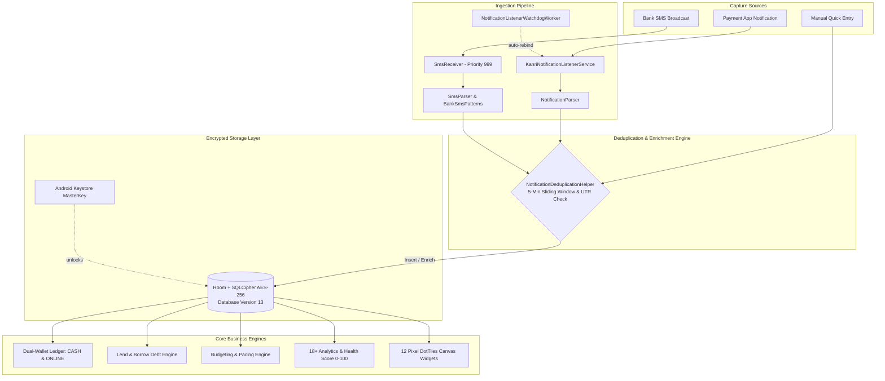

# Kanri — Comprehensive Application Documentation & System Architecture Manual

**Current Version:** 1.19.8 (Build 75)  
**Package Name:** `com.omkarnub.kanri`  
**License:** GNU General Public License v3.0 ([GPL-3.0](https://www.gnu.org/licenses/gpl-3.0.en.html))  
**Target Platform:** Android 8.0+ (API Level 26 through API Level 37)  
**Primary Language:** Kotlin 2.2.10 (Jetpack Compose BOM 2026.02.01, Material Design 3)  
**Architecture Pattern:** Clean Architecture (UI Layer → ViewModel Layer → Repository Layer → Encrypted Local Data Source)  
**Encryption:** SQLCipher 4.6.1 (AES-256 GCM) backed by Android Keystore hardware keys  

---

## Table of Contents

- [1. Executive Overview & Product Philosophy](#1-executive-overview--product-philosophy)
  - [1.1 What is Kanri?](#11-what-is-kanri)
  - [1.2 The Problem with Modern Financial Trackers](#12-the-problem-with-modern-financial-trackers)
  - [1.3 Core Tenets: Zero Cloud, Extreme Tactility, Zero Friction](#13-core-tenets-zero-cloud-extreme-tactility-zero-friction)
  - [1.4 High-Level Feature Overview](#14-high-level-feature-overview)
- [2. System Architecture & End-to-End Data Flow](#2-system-architecture--end-to-end-data-flow)
  - [2.1 Clean Architecture & Unidirectional Data Flow (UDF)](#21-clean-architecture--unidirectional-data-flow-udf)
  - [2.2 Cryptographic Boundaries & Database Security](#22-cryptographic-boundaries--database-security)
  - [2.3 High-Level Data Flow Diagram](#23-high-level-data-flow-diagram)
  - [2.4 Lifecycle & Process Death Handling](#24-lifecycle--process-death-handling)
- [3. Dual-Engine Automated Transaction Capture Pipeline](#3-dual-engine-automated-transaction-capture-pipeline)
  - [3.1 Architectural Principles of Capture](#31-architectural-principles-of-capture)
  - [3.2 SMS Broadcast Parsing Subsystem (`SmsReceiver`, `SmsParser`, `BankSmsPatterns`)](#32-sms-broadcast-parsing-subsystem-smsreceiver-smsparser-banksmspatterns)
  - [3.3 Payment Notification Listener Subsystem (`KanriNotificationListenerService`)](#33-payment-notification-listener-subsystem-kanrinotificationlistenerservice)
  - [3.4 Watchdog Self-Healing & Boot Auto-Rebinding](#34-watchdog-self-healing--boot-auto-rebinding)
  - [3.5 5-Minute Sliding-Window Deduplication & Bi-Directional Enrichment](#35-5-minute-sliding-window-deduplication--bi-directional-enrichment)
  - [3.6 Instant Detection Floating Overlay (`InstantPopupService`)](#36-instant-detection-floating-overlay-instantpopupservice)
- [4. Financial Core, Multi-Wallet & Currency Ledger](#4-financial-core-multi-wallet--currency-ledger)
  - [4.1 The Transaction Data Model (`TransactionEntity`, `TransactionDao`)](#41-the-transaction-data-model-transactionentity-transactiondao)
  - [4.2 The Dual-Wallet Architecture: `CASH` vs. `ONLINE`](#42-the-dual-wallet-architecture-cash-vs-online)
  - [4.3 ATM Cash Withdrawal Intelligence (`AtmWithdrawalMode`)](#43-atm-cash-withdrawal-intelligence-atmwithdrawalmode)
  - [4.4 Category Management & Counterparty Mapping](#44-category-management--counterparty-mapping)
  - [4.5 Multi-Currency Formatting Engine (`CurrencyUtils`, `CurrencyPreferences`)](#45-multi-currency-formatting-engine-currencyutils-currencypreferences)
- [5. Lend & Borrow Ledger (Debt Management & Bill Splitting)](#5-lend--borrow-ledger-debt-management--bill-splitting)
  - [5.1 Debt & Credit Architecture (`LendingEntity`, `LendingRepaymentEntity`)](#51-debt--credit-architecture-lendingentity-lendingrepaymententity)
  - [5.2 Partial Repayments & Settlement History](#52-partial-repayments--settlement-history)
  - [5.3 WhatsApp Payment Reminders & UPI Deep Link Generation](#53-whatsapp-payment-reminders--upi-deep-link-generation)
  - [5.4 Multi-Party Bill Splitting Engine (`SplitExpenseSheet`)](#54-multi-party-bill-splitting-engine-splitexpensesheet)
  - [5.5 Transaction-to-Lending Bridge](#55-transaction-to-lending-bridge)
- [6. Budgets, Cycles & Savings Milestones](#6-budgets-cycles--savings-milestones)
  - [6.1 Flexible Budgeting & Custom Cycles (`budgetCycleStartDay`)](#61-flexible-budgeting--custom-cycles-budgetcyclestartday)
  - [6.2 Safe-to-Spend Daily Allowance Calculation](#62-safe-to-spend-daily-allowance-calculation)
  - [6.3 Savings Goals Engine (`SavingsGoalEntity`, `SavingsGoalContributionEntity`)](#63-savings-goals-engine-savingsgoalentity-savingsgoalcontributionentity)
  - [6.4 Dynamic Pacing Calculations & Quick Stepper Contributions](#64-dynamic-pacing-calculations--quick-stepper-contributions)
- [7. Analytics, Visualizations & Financial Health Score](#7-analytics-visualizations--financial-health-score)
  - [7.1 18+ Analytical Visualizations](#71-18-analytical-visualizations)
  - [7.2 The 0–100 Financial Health Score Engine (`FinancialHealthCalculator`)](#72-the-0100-financial-health-score-engine-financialhealthcalculator)
  - [7.3 Smart Merchant Rules & Interactive Simulator](#73-smart-merchant-rules--interactive-simulator)
- [8. Pixel DotTiles Widget Subsystem & Quick Integrations](#8-pixel-dottiles-widget-subsystem--quick-integrations)
  - [8.1 Dot-Matrix Visual System (`PixelFont`, `Ndot57`)](#81-dot-matrix-visual-system-pixelfont-ndot57)
  - [8.2 Pure Canvas Shared Engine (RemoteViews & In-App Compose Previews)](#82-pure-canvas-shared-engine-remoteviews--in-app-compose-previews)
  - [8.3 Catalog of 12 Specialized Home Screen Widgets](#83-catalog-of-12-specialized-home-screen-widgets)
  - [8.4 Midnight Reset Subsystem (`MidnightWidgetResetWorker`)](#84-midnight-reset-subsystem-midnightwidgetresetworker)
  - [8.5 Quick Settings Tile & Floating Numpad Entry](#85-quick-settings-tile--floating-numpad-entry)
- [9. The Liquid Glass Engine, Theming & Tactile UX](#9-the-liquid-glass-engine-theming--tactile-ux)
  - [9.1 Five Distinct Visual Themes](#91-five-distinct-visual-themes)
  - [9.2 Liquid Glass Engine: Haze Blurs, AGSL Shaders & 22 Animated Backdrops](#92-liquid-glass-engine-haze-blurs-agsl-shaders--22-animated-backdrops)
  - [9.3 Touch-Pause Zero-Stutter Pipeline & Mali GPU Optimizations](#93-touch-pause-zero-stutter-pipeline--mali-gpu-optimizations)
  - [9.4 Dynamic Launcher App Icons (`AppIconManager`)](#94-dynamic-launcher-app-icons-appiconmanager)
  - [9.5 Calibrated Dual-Engine Haptics (LRA Waveforms + ERM Micro-Pulses)](#95-calibrated-dual-engine-haptics-lra-waveforms--erm-micro-pulses)
- [10. Security, Privacy & Data Sovereignty](#10-security-privacy--data-sovereignty)
  - [10.1 Zero Telemetry & Threat Model](#101-zero-telemetry--threat-model)
  - [10.2 Biometric Lock & Screen-Off Auto-Lock](#102-biometric-lock--screen-off-auto-lock)
  - [10.3 Encrypted Local Backup & Restoration (`BackupCryptoHelper`)](#103-encrypted-local-backup--restoration-backupcryptohelper)
  - [10.4 Client-Side Encrypted Google Drive Sync (`drive.file` Scope)](#104-client-side-encrypted-google-drive-sync-drivefile-scope)
  - [10.5 Statement Exporting (CSV & JSON)](#105-statement-exporting-csv--json)
- [11. Comprehensive Package Directory & Codebase File Map](#11-comprehensive-package-directory--codebase-file-map)
- [12. Build System, Testing Suite & Developer Operations](#12-build-system-testing-suite--developer-operations)

---

## 1. Executive Overview & Product Philosophy

### 1.1 What is Kanri?
**Kanri** (管理 — Japanese for *management*, *governance*, or *control*) is an offline-first, cryptographic personal finance operating system for Android. It bridges the gap between passive manual expense loggers and intrusive banking aggregators.

Kanri observes incoming transactional SMS messages and UPI/banking push notifications directly on the user's device, parses payment amounts, merchants, and account identifiers in real time, and immediately updates an on-device double-entry ledger. It operates **100% offline**, requiring no user accounts, no credit bureau checks, no cloud database credentials, and zero analytics telemetry.

### 1.2 The Problem with Modern Financial Trackers
Contemporary commercial expense trackers suffer from structural flaws:
1. **Aggressive Telemetry & Data Harvesting:** Traditional apps send raw SMS logs, merchant habits, and financial net worth to centralized third-party servers for targeted advertising, credit profiling, or cross-selling financial products.
2. **Fragile Cloud Dependency:** Apps cease functioning without internet access or when their centralized backends go offline.
3. **Cluttered UI & Predatory Upselling:** Ad banners, personal loan promos, and credit score popups distract from core financial clarity.
4. **Neglect of Personal Debts:** Most spending trackers only count unilateral debit/credit outflows, completely failing to model money lent to friends, money borrowed, split dinners, or partial settlements.

### 1.3 Core Tenets: Zero Cloud, Extreme Tactility, Zero Friction
Kanri is designed around three non-negotiable architectural principles:
- **Zero Cloud by Default:** All financial records, categories, account tallies, and merchant rules are stored locally in an AES-256 encrypted SQLite database using SQLCipher. No Kanri backend server exists.
- **Extreme Tactility & Quiet Aesthetics:** Built with a minimal, dark-first visual palette (matte `#121212`, AMOLED `#000000`, or Frosted Glass), authentic typography (Panchang display headers with Google Sans Flex body), and micro-calibrated haptics tuned for Linear Resonant Actuators.
- **Zero-Friction Ingestion:** Automated dual-engine capture eliminates manual typing fatigue. When an SMS arrives or a UPI app alerts payment, Kanri captures the transaction instantly.

### 1.4 High-Level Feature Overview
| Subsystem | Key Capabilities |
| :--- | :--- |
| **Dual-Engine Capture** | Real-time SMS parsing (15+ Indian banks) + `NotificationListenerService` (UPI apps), 5-min sliding deduplication, instant floating prompt. |
| **Multi-Wallet Ledger** | Isolated tracking of physical `CASH` vs. digital `ONLINE` balances, automatic ATM withdrawal handling, and inter-wallet transfers. |
| **Lend & Borrow** | Dedicated debt ledger, partial repayment timelines, auto-generated WhatsApp reminders, pre-filled UPI deep links, and multi-person bill splitting. |
| **Budgets & Goals** | Custom monthly budget cycles (e.g., 5th to 4th for salary cycles), daily safe-to-spend allowance, target savings deadlines with required daily/monthly pacing. |
| **Insights & Analytics** | 18+ visual tools including GitHub-style daily spend heatmaps, 365-day matrices, month-end burn rate projections, and a 0–100 Financial Health Score. |
| **Pixel DotTiles Widgets**| 12 home screen widgets built on a custom 7-row canvas dot-matrix engine (`PixelFont`/`Ndot57`), with 1:1 in-app live previews and midnight reset workers. |
| **Liquid Glass Engine** | 22 animated shaders and backdrops, AGSL GPU shaders with Mali 16-bit half-precision optimization, Haze frosted glass, and gesture touch-pause. |
| **Security & Privacy** | SQLCipher AES-256 database, Android Keystore `MasterKey`, Biometric Lock with screen-off auto-lock, and PBKDF2-encrypted local & Google Drive backups. |

---

## 2. System Architecture & End-to-End Data Flow

### 2.1 Clean Architecture & Unidirectional Data Flow (UDF)
Kanri strictly follows Clean Architecture principles, ensuring modularity, isolation, and unit testability:

```
┌────────────────────────────────────────────────────────┐
│                      UI Layer                          │
│  - Jetpack Compose Screens & Reusable Components       │
│  - RemoteViews Bitmaps (Pixel DotTiles Canvas Engine)   │
│  - Floating Overlays & Dialog Activities               │
└───────────────────────────▲────────────────────────────┘
                            │ StateFlow / Immutable State
┌───────────────────────────▼────────────────────────────┐
│                   ViewModel Layer                      │
│  - State Hoisting & Business Orchestration             │
│  - Pure Functional Transformations & Math Engines       │
└───────────────────────────▲────────────────────────────┘
                            │ Coroutines (Flow / suspend)
┌───────────────────────────▼────────────────────────────┐
│                  Repository Layer                      │
│  - Deduplication Coordination                          │
│  - Preference Stores & Crypto Key Management           │
└───────────────────────────▲────────────────────────────┘
                            │ Room DAOs / SharedPreferences
┌───────────────────────────▼────────────────────────────┐
│                Local Data Source Layer                 │
│  - SQLCipher Encrypted SQLite Database (Room v13)      │
│  - Hardware-Backed EncryptedSharedPreferences          │
│  - Local App Storage (No Plaintext Secrets)            │
└────────────────────────────────────────────────────────┘
```

### 2.2 Cryptographic Boundaries & Database Security
1. **Passphrase Generation & Hardware Sealing:**
   - On first launch, `DatabaseKeyManager` invokes `SecureRandom` to generate a 256-bit (32-byte) cryptographically strong random key.
   - This key is stored inside `EncryptedSharedPreferences` protected by Android Keystore's `MasterKey` (`AES256_GCM` scheme for value encryption and `AES256_SIV` for key encryption).
2. **SQLCipher AES-256 Integration:**
   - Room initializes using Zetetic's `SupportOpenHelperFactory(passphrase)`.
   - Every database page written to disk (`kanri_database`) is encrypted at rest using AES-256. Raw SQLite inspectors or rooted device file extractions encounter only high-entropy ciphertext.
3. **Graceful Key Recovery & Anti-Brick Safeguards:**
   - `KanriDatabase.ensureDatabaseCanBeOpened()` performs a diagnostic header check during database startup. If corruption or unrecoverable key loss occurs, it isolates the corrupt file to prevent permanent boot crashes.

### 2.3 High-Level Data Flow Diagram



### 2.4 Lifecycle & Process Death Handling
- **Android Configuration Changes:** State is retained in ViewModels via `StateFlow` and Compose `rememberSaveable`.
- **Process Death & Memory Reclamation:** Critical navigation parameters and bottom-sheet form inputs survive OS memory reclaim cycles.
- **Screen-Off Event Monitoring:** `ScreenLockWatcher` monitors `Intent.ACTION_SCREEN_OFF`. The instant the display turns off, security gates lock immediately, requiring biometric authentication upon resumption.

---

## 3. Dual-Engine Automated Transaction Capture Pipeline

### 3.1 Architectural Principles of Capture
Kanri uses a **dual-engine ingestion architecture**:
1. **SMS is Authoritative for Debits:** Because Indian banks are mandated by the Reserve Bank of India (RBI) to dispatch regulatory SMS alerts for all debit card, net banking, and UPI outflows, SMS is treated as the primary source of truth for debits.
2. **Notifications are Supplementary for Credits & Payee Enrichment:** Notification listener handles incoming UPI credits (money received) and provides clean, human-readable merchant names (e.g., "Starbucks Coffee") which can be used to enrich cryptic bank SMS strings (e.g., `UPI/P2M/432109876543/STARBUCKS`).

### 3.2 SMS Broadcast Parsing Subsystem (`SmsReceiver`, `SmsParser`, `BankSmsPatterns`)
- **Broadcast Receiver:** `SmsReceiver` is registered with maximum system priority (`android:priority="999"`) and requires `android.permission.BROADCAST_SMS`.
- **Supported Banks:** Over 15 major Indian public and private financial institutions are supported with specialized regex patterns in `BankSmsPatterns.kt`:
  - **Public Sector:** State Bank of India (SBI), Bank of Baroda (BOB), Punjab National Bank (PNB), Canara Bank, Union Bank of India, Bank of India (BOI), Indian Bank, Central Bank of India, UCO Bank, Bank of Maharashtra, Punjab & Sind Bank, Indian Overseas Bank.
  - **Private Sector:** HDFC Bank, ICICI Bank, Axis Bank, Kotak Mahindra Bank, IDFC FIRST Bank, IndusInd Bank, Yes Bank, Federal Bank, RBL Bank, IDBI Bank.
- **Parsing Logic:**
  - Extracts **amount** (handles `Rs.`, `INR`, `₹`), **transaction type** (Debit vs. Credit vs. ATM), **account identifier** (last 4 digits), **reference number** (12-digit UTR or RRN), and **counterparty/merchant**.
  - Handles reversal notices, failed transaction notices, and OTP messages (OTP messages are strictly ignored and never persisted).

### 3.3 Payment Notification Listener Subsystem (`KanriNotificationListenerService`)
- Extends Android's `NotificationListenerService`, scoped strictly to financial and payment packages.
- **Whitelisted Packages:**
  - *UPI & Wallets:* Google Pay (`com.google.android.apps.nbu.paisa.user`), PhonePe (`com.phonepe.app`), Paytm (`net.one97.paytm`), CRED (`club.cred.android`), FamPay (`in.fampay`), BHIM (`in.org.npci.upiapp`), Amazon Pay (`in.amazon.mShop.android.shopping`).
  - *Neobanks & Credit Apps:* Navi, Jupiter, Fibe.
  - *Direct Bank Mobile Apps:* HDFC Mobile, ICICI iMobile, SBI YONO, Axis Mobile, Kotak 811, PNB One, BOB World, IDFC Optimus.
- Ignores messaging apps (WhatsApp, Telegram, Signal) to ensure absolute user privacy.

### 3.4 Watchdog Self-Healing & Boot Auto-Rebinding
On various aggressive OEM Android skins (MIUI, ColorOS, OxygenOS, FuntouchOS), the OS occasionally kills background notification listener services without unbinding them.
- **`BootReceiver`:** Automatically triggers `KanriNotificationListenerService.rebindService()` upon device boot (`BOOT_COMPLETED`, `MY_PACKAGE_REPLACED`).
- **`NotificationListenerWatchdogWorker`:** A periodic WorkManager worker that queries `KanriNotificationListenerService.isConnected`. If the system has silently revoked the binder connection while the permission remains enabled, it forces an instant rebind request.

### 3.5 5-Minute Sliding-Window Deduplication & Bi-Directional Enrichment
When a user pays at a store via UPI, both a payment app notification and a bank SMS arrive within seconds. Without deduplication, this would record the expense twice.

`NotificationDeduplicationHelper` coordinates cross-channel reconciliation:
1. **Exact Reference (UTR) Match:** If a transaction arrives with a 12-digit UTR that already exists in the database, it is recognized as a duplicate.
2. **5-Minute Temporal Sliding Window (`DEDUPE_WINDOW_MS = 300,000 ms`):**
   - If an incoming transaction matches an existing record within $\pm 5$ minutes with identical amount and transaction type (Debit/Credit), Kanri treats them as the same event.
3. **Bi-Directional Enrichment:**
   - If the notification arrived first: the subsequent bank SMS enriches the record with the official bank institution name, exact UTR ref number, and audit raw SMS.
   - If the bank SMS arrived first: the subsequent notification enriches the record by replacing cryptic bank codes with the clean merchant/payee name.

### 3.6 Instant Detection Floating Overlay (`InstantPopupService`)
When an expense or income is captured while the user is outside Kanri, an interactive floating card can appear (`InstantPopupService` utilizing `SYSTEM_ALERT_WINDOW`):
- Displays the parsed amount, payee, and detected category.
- Provides one-tap category reassignment chips.
- Allows adding a quick note or converting the expense into a split bill / lend record immediately.
- Auto-dismisses after interaction with smooth spring physics.

---

## 4. Financial Core, Multi-Wallet & Currency Ledger

### 4.1 The Transaction Data Model (`TransactionEntity`, `TransactionDao`)
Every financial movement in Kanri is modeled by `TransactionEntity`:
- `id` (Long, auto-generated primary key)
- `type` (`"DEBIT"` or `"CREDIT"`)
- `amount` (Double)
- `source_type` (`"UPI"`, `"ATM"`, `"CARD"`, `"BANK_TRANSFER"`, `"WALLET_TRANSFER"`, `"UNKNOWN"`)
- `counterparty` (String: VPA, merchant name, or payee)
- `displayName` (String: enriched human-readable title)
- `bank` (String: issuing bank or payment provider)
- `refNo` (String: UTR or reference number)
- `timestamp` (Long: epoch milliseconds)
- `categoryId` (Long: foreign key to `categories`)
- `rawSms` (String: audit trail of original text)
- `isDuplicate` (Boolean: soft-deleted from totals)
- `isManualEntry` (Boolean: manual vs. automated)
- `needsReview` / `reviewReason` (Flags transactions needing user attention)
- `notes` (User-entered metadata)
- `wallet` (`"ONLINE"` or `"CASH"`)
- `transferToWallet` (Nullable String: denotes inter-wallet transfer)

### 4.2 The Dual-Wallet Architecture: `CASH` vs. `ONLINE`
Unlike standard expense trackers that lump all money into one pool, Kanri separates liquid physical currency from digital bank/UPI accounts:
- **`ONLINE` Wallet:** Synchronizes all electronic UPI, debit card, and net-banking transactions.
- **`CASH` Wallet:** Tracks physical paper notes and coins.
- **Net Worth Calculation:** Total liquid assets $= \text{Cash Balance} + \text{Online Balance}$.
- **Inter-Wallet Transfers (`MoveMoneyDialog`):** Moving money between cash and online (e.g. withdrawing cash or depositing money into a branch) creates linked transactions that shift liquidity without altering overall net spend.

### 4.3 ATM Cash Withdrawal Intelligence (`AtmWithdrawalMode`)
When an ATM withdrawal SMS is detected (e.g., *"₹5,000 debited via ATM"*), users can configure how Kanri handles it:
1. **Mode A (`SPENDING`):** Treats the withdrawal as an immediate expense under "Cash & ATM". Useful for users who do not wish to log micro cash transactions.
2. **Mode B (`TRANSFER_TO_CASH`):** Automatically creates a transfer from `ONLINE` wallet to `CASH` wallet. The user's online balance decreases by ₹5,000, physical cash increases by ₹5,000, and overall net spending remains ₹0 until cash transactions are spent.

### 4.4 Category Management & Counterparty Mapping
- **19 Default Categories:** Auto / Taxi Fare, Food & Dining, Train & Metro, Groceries, Shopping, Bills & Utilities, Transport & Fuel, Entertainment, Health & Medical, Salary & Income, Investment & Savings, Education, Cash & ATM, Rent & Maintenance, Personal Care, Gifts & Donations, Travel & Vacation, Lend & Borrow, Other.
- **Custom Categories:** Users can add custom categories with curated icons and colors.
- **Display Ordering:** `display_order` enables reordering categories for personalized quick-selection grids.
- **Counterparty Mapping (`CounterpartyCategoryMapEntity`):** Maps recurring keywords (e.g., "Swiggy" → Food & Dining) to auto-tag transactions without manual intervention.

### 4.5 Multi-Currency Formatting Engine (`CurrencyUtils`, `CurrencyPreferences`)
- **Global Currency Support:** Supports Indian Rupee (`₹`), US Dollar (`$`), Euro (`€`), British Pound (`£`), Japanese Yen (`¥`), Canadian Dollar (`CA$`), Australian Dollar (`AU$`), and others.
- **Indian Numbering Formatting:** Properly formats values according to regional standards (e.g., ₹1,00,000 Lakhs and Crores for INR, and standard million/billion grouping for international currencies).
- **Synchronized UI & Widgets:** Changes in currency settings propagate immediately across all Compose screens and home screen widgets.

---

## 5. Lend & Borrow Ledger (Debt Management & Bill Splitting)

### 5.1 Debt & Credit Architecture (`LendingEntity`, `LendingRepaymentEntity`)
Kanri features a dedicated peer-to-peer debt ledger that tracks money outside personal spending:
- **`LENT`:** Money you have paid on behalf of someone else (they owe you).
- **`BORROWED`:** Money someone paid on your behalf (you owe them).
- **Net Exposure:** $\sum \text{Lent Pending} - \sum \text{Borrowed Pending}$.

### 5.2 Partial Repayments & Settlement History
Instead of requiring an all-or-nothing settlement, Kanri supports incremental repayments:
- `LendingRepaymentEntity` stores the repayment `amount`, `paid_at` timestamp, and optional `note`.
- When partial payments are logged, the outstanding principal decreases accordingly.
- Cascading foreign keys ensure that deleting a loan cleans up its associated repayment history cleanly.

### 5.3 WhatsApp Payment Reminders & UPI Deep Link Generation
- **WhatsApp Direct Reminders (`LendingReminderUtils`):** Generates polite, pre-formatted payment reminder messages including contact name, outstanding amount, due date, and repayment notes. Opens directly in WhatsApp via Android intents.
- **UPI Deep Link Settlement (`LendingUpiHelper`):** Generates an instant payment URI:
  ```
  upi://pay?pa=<UPI_ID>&pn=<NAME>&am=<AMOUNT>&cu=INR&tn=Kanri%20Settlement
  ```
  Tapping "Pay via UPI" opens the user's preferred payment app (GPay, PhonePe, Paytm) with recipient, amount, and notes pre-filled.

### 5.4 Multi-Party Bill Splitting Engine (`SplitExpenseSheet`)
When dining out or traveling in a group:
1. User logs a master transaction (e.g. ₹3,000 restaurant bill paid by user).
2. The bill splitter splits the amount between 2 to 20 people.
3. Supports **Equal Splits** or **Custom Amounts** per person.
4. Automatically calculates the user's own share and generates individual `LENT` records for all participants in a single operation.

### 5.5 Transaction-to-Lending Bridge
If a user realizes an existing debit transaction in their history was actually paid on behalf of a friend, `LendingTransactionBridgeDialog` converts that debit directly into a `LENT` debt record, linking the transaction ID and adjusting personal spending totals.

---

## 6. Budgets, Cycles & Savings Milestones

### 6.1 Flexible Budgeting & Custom Cycles (`budgetCycleStartDay`)
Standard budgeting apps force calendar-month limits (1st to 30th/31st). Most working professionals receive salaries between the 25th and 5th of the month.
- Kanri supports **Custom Budget Cycle Start Days** (`budgetCycleStartDay` $\in [1, 28]$).
- If set to the 5th, a budget cycle runs from the 5th of Month $M$ to the 4th of Month $M+1$.
- All analytical aggregations, widgets, and budget meters shift to align with this cycle.

### 6.2 Safe-to-Spend Daily Allowance Calculation
Kanri computes an adaptive safe-to-spend metric:
$$\text{Safe Daily Allowance} = \frac{\text{Budget Limit} - \text{Cycle Spend to Date}}{\text{Days Remaining in Active Cycle}}$$
- **Positive:** You have headroom to spend comfortably each day.
- **Negative / Zero:** Budget is depleted; displays overrun warning and suggests daily frugality target.

### 6.3 Savings Goals Engine (`SavingsGoalEntity`, `SavingsGoalContributionEntity`)
- **Target Tracking:** Set title (e.g., "Emergency Fund", "New Laptop"), target monetary sum, emoji icon, color accent, and optional target deadline.
- **Milestone Visualizer:** Circular progress rings display percentage completion and milestone badges (25%, 50%, 75%, 100%).
- **Contribution History:** Every deposit is recorded with timestamps and optional source transaction links.

### 6.4 Dynamic Pacing Calculations & Quick Stepper Contributions
`SavingsGoalCalculator` continuously calculates pacing:
- Determines required daily, weekly, and monthly savings rates needed to reach the goal by the target date.
- **Quick Steppers:** Add funds via one-tap increment buttons (+₹500, +₹1,000, +₹2,000, +₹5,000) for friction-free updates.

---

## 7. Analytics, Visualizations & Financial Health Score

### 7.1 18+ Analytical Visualizations
1. **GitHub-Style Calendar Heatmap:** Visualizes daily spending density with intensity shading.
2. **365-Day Year Matrix:** Full-year interactive matrix for spotting macro seasonal spending patterns.
3. **Month-End Burn Rate & Projection Line:** Projects final month-end spending based on current daily velocity and historical trends.
4. **Cumulative Spend Line Chart:** Plots day-by-day spend trajectory compared to the previous month.
5. **Category Movers:** Highlights categories with highest growth or contraction compared to historical averages.
6. **Top Payees & Merchant Intelligence:** Detailed drill-down on total spending per merchant over time.
7. **Payment Method Breakdown:** Percentage distribution between UPI, Credit Card, Debit Card, Cash, and Net Banking.
8. **Month Comparison Screen:** Side-by-side comparative analysis of any two months.
9. **Monthly Recap Cards:** Story-style end-of-month summary cards highlighting achievements and records.

### 7.2 The 0–100 Financial Health Score Engine (`FinancialHealthCalculator`)
Kanri calculates a holistic 0–100 Financial Health Score built on **4 Mathematical Pillars**:

| Pillar | Weight | Metric Evaluated | Healthy Benchmark |
| :--- | :---: | :--- | :--- |
| **1. Savings Pillar** | 25 pts | Net Savings Rate $= \frac{\text{Income} - \text{Spend}}{\text{Income}}$ | $\ge 20\%$ saved |
| **2. Budget Pillar** | 25 pts | Budget Adherence $= \frac{\text{Spend}}{\text{Budget Limit}}$ | $\le 90\%$ of allocated budget |
| **3. Velocity Pillar** | 25 pts | Spend Velocity vs. Calendar Pace | Spending slower than calendar progress |
| **4. Debt Pillar** | 25 pts | Net Debt Ratio $= \frac{\text{Borrowed Dues}}{\text{Total Liquid Assets}}$ | Zero high-risk un-settled debt |

**Grading Scale:**
- **A+ (Exceptional, 90–100):** Outstanding fiscal discipline; high savings and minimal debt.
- **A (Healthy, 75–89):** Well-balanced spending; on track with budget goals.
- **B (Balanced, 60–74):** Moderate control; minor budget strain or elevated velocity.
- **C (Caution, 40–59):** Elevated spending velocity; budget near exhaustion.
- **D (At Risk, 0–39):** Over budget; high borrowing or negative cashflow.

### 7.3 Smart Merchant Rules & Interactive Simulator
- **Rule Engine:** Matches transaction counterparty strings against user-defined keywords using a longest-match strategy.
- **Interactive Simulator (`SmartMerchantRulesScreen`):** Allows users to type arbitrary merchant strings (e.g. `BLR*SWIGGY INSTAMART`) and immediately test which rule fires, showing confidence and target category preview before saving.

---

## 8. Pixel DotTiles Widget Subsystem & Quick Integrations

### 8.1 Dot-Matrix Visual System (`PixelFont`, `Ndot57`)
Kanri features a distinctive widget design system inspired by tactile dot-matrix hardware (Nothing-style DotTiles). Custom typefaces (`PixelFont` and `Ndot57`) are rendered onto an 8×8 and 5×7 dot matrix using a shared Canvas engine.

### 8.2 Pure Canvas Shared Engine (RemoteViews & In-App Compose Previews)
Instead of relying on fragile Android XML layouts for widgets, Kanri renders widgets directly onto in-memory `Bitmap` surfaces via `WidgetRenderer.kt`:
- **Pixel-for-Pixel Parity:** The exact same rendering engine generates the `RemoteViews` bitmaps for the Android launcher and the interactive live previews inside `WidgetsScreen.kt`.
- **Memory Optimization:** Uses recycled bitmapped buffers and `ThreadLocal<Paint>` instances to eliminate GC pressure.

### 8.3 Catalog of 12 Specialized Home Screen Widgets
1. **Today Spend:** Real-time today's total spend with dot-matrix numerical digits.
2. **Month Delta:** Comparison of current month spending versus the same day last month.
3. **Safe to Spend:** Daily remaining spending allowance.
4. **Budget Ring:** Circular dot-matrix gauge showing budget consumption.
5. **Streak Counter:** Consecutive zero-spend / under-budget days.
6. **Dues & Debts:** Net pending money owed to you vs. money you owe.
7. **Savings Goals:** Progress towards primary milestone targets.
8. **Review Inbox:** Badge count of untagged or auto-flagged transactions needing review.
9. **Quick Actions:** One-tap shortcuts to add Expense, Income, Split Bill, or Scan QR.
10. **Spend Heatmap:** Miniature 7-column weekly/monthly spending intensity grid.
11. **Wallets Summary:** Dual cash and online account balances.
12. **Sky Atmosphere:** Ambient visual widget reflecting budget health through dynamic weather-inspired dot patterns.

### 8.4 Midnight Reset Subsystem (`MidnightWidgetResetWorker`)
At `00:00:00` local time every night, WorkManager executes `MidnightWidgetResetWorker`:
- Resets "Today Spend" meters back to zero.
- Re-evaluates no-spend streaks.
- Re-renders all active home screen widgets with fresh daily metrics.

### 8.5 Quick Settings Tile & Floating Numpad Entry
- **Quick Settings Tile (`QuickAddTileService`):** Pull down the Android notification shade from anywhere (even from inside other apps or lock screen) and tap "Add Expense" to trigger instant entry.
- **Floating Quick Entry Activity (`QuickEntryActivity`):** Launches a lightweight floating numpad dialog (`Theme.Kanri.QuickEntry`) directly above the launcher with frosted glass blur, enabling instant logging in under 3 seconds without loading the full app UI.

---

## 9. The Liquid Glass Engine, Theming & Tactile UX

### 9.1 Five Distinct Visual Themes
1. **Light Mode:** High-contrast neutral light interface.
2. **Dark Mode:** Deep matte `#121212` aesthetic for reduced eye fatigue.
3. **AMOLED Mode:** Pitch black `#000000` background that turns off OLED pixels to conserve battery life.
4. **System Mode:** Seamlessly tracks Android OS system day/night switching.
5. **Glass Mode:** Ultra-premium glassmorphic interface with real-time frosted glass materials, specular lighting, and animated backdrops.

### 9.2 Liquid Glass Engine: Haze Blurs, AGSL Shaders & 22 Animated Backdrops
When Glass Mode is active, Kanri leverages **Haze** (`dev.chrisbanes.haze`) and native **AGSL (Android Graphics Shading Language)** on Android 13+ (API 33+):
- **Frosted Glass Blur:** Surfaces sample backdrop pixels and apply multi-pass Gaussian blur with specular highlights.
- **22 Animated Artwork Backdrops:**
  - *Generative Shaders:* Gemini Aurora, Grain Gradient, Hero Geometric, Prism Swirl, Cloudscape, Ink Ridges, Sumi-e Mist.
  - *Artistic Japanese & Scenic Themes:* Fuji & Sakura, Thistle Portico, Still Sunset Meadow, Twilight Meadow, Tokyo Night, Pixel Kitchen, Snowy Mountain Road, Sunlit Balcony, Alpine Valley, Shiganshina Windmill, Chibi Coffee Shop, Fuji Torii Gate, Cherry Blossom Canyon, Pixel Misty Alley, Glowing Bamboo Forest.
- **Strict Theme Decoupling:** In solid themes (Light, Dark, AMOLED), zero WebViews or AGSL background shaders are mounted, guaranteeing absolute 0% GPU/battery overhead.

### 9.3 Touch-Pause Zero-Stutter Pipeline & Mali GPU Optimizations
Mid-range mobile GPUs (such as the ARM Mali-G57 MC2) can experience frame drops when rendering complex background shaders and real-time blurs simultaneously during list flings. Kanri eliminates this via:
- **AGSL Half-Precision Optimization:** Vector math, color blending, and noise functions are executed in 16-bit `half` precision, doubling ALU throughput.
- **Uniform Hoisting:** Screen aspect ratio (`u_aspect`) is precomputed on the CPU, saving over 650,000 divisions per frame.
- **Touch-Pause Gesture Freeze (`MainActivity.isUserInteracting`):** The instant a finger touches the screen to scroll or drag, shader animations pause immediately. This prevents background redraws from dirtying `hazeSource` during scrolling, locking scroll performance to a smooth 120 FPS.
- **In-List Blur Elimination:** In-content list cards utilize lightweight frosted tints, reserving expensive multi-pass Gaussian blurs strictly for floating overlays and navigation bars.

### 9.4 Dynamic Launcher App Icons (`AppIconManager`)
Users can choose between Light and Dark launcher icons without breaking Android shortcuts or home screen placements:
- Implemented using 4 distinct `<activity>` launcher aliases in `AndroidManifest.xml`:
  - `MainActivityDarkDark` (Dark Icon + Dark Splash)
  - `MainActivityDarkLight` (Dark Icon + Light Splash)
  - `MainActivityLightDark` (Light Icon + Dark Splash)
  - `MainActivityLightLight` (Light Icon + Light Splash)
- `AppIconManager` dynamically enables/disables package components via `PackageManager.setComponentEnabledSetting()`.

### 9.5 Calibrated Dual-Engine Haptics (LRA Waveforms + ERM Micro-Pulses)
Kanri's haptic subsystem (`HapticFeedbackHelper`) delivers tactile physical feedback:
- **Linear Resonant Actuators (LRA):** On modern smartphones, uses `VibrationEffect.createPredefined()` to produce sharp clicks, ticks, and confirmation thuds.
- **Eccentric Rotating Mass (ERM) Fallback:** On older devices, automatically translates commands into gentle 3–8 ms micro-vibration pulses, preventing the phone from buzzing loudly on simple taps.

---

## 10. Security, Privacy & Data Sovereignty

### 10.1 Zero Telemetry & Threat Model
- **No Third-Party Analytics:** Zero tracking SDKs (no Google Analytics, no Firebase Crashlytics, no Mixpanel, no Sentry).
- **No Advertising SDKs:** No promotional networks or banner SDKs.
- **No Credential Harvesting:** Kanri never prompts for internet banking usernames, passwords, card CVVs, or ATM PINs.
- **Full Offline Operation:** The app functions indefinitely with Wi-Fi and mobile data disabled.

### 10.2 Biometric Lock & Screen-Off Auto-Lock
- **BiometricPrompt Integration:** Secures the app with Android Biometrics (Fingerprint, Face Unlock, or Device PIN fallback).
- **Screen-Off Auto-Lock:** The app registers a broadcast receiver for `Intent.ACTION_SCREEN_OFF`. The instant the device display turns off, Kanri locks immediately.
- **Recents Screen Privacy:** In-app screens can obscure their snapshots in the Android task switcher to prevent sensitive balances from leaking in recent app previews.

### 10.3 Encrypted Local Backup & Restoration (`BackupCryptoHelper`)
- **AES-256 GCM Encryption:** Backups are serialized into JSON and encrypted using `AES/GCM/NoPadding` with a 256-bit key derived via **PBKDF2WithHmacSHA256**.
- **Cryptographic Salt & Iterations:** Employs a unique 16-byte random salt, a 12-byte initialization vector (IV), and 65,536 hash iterations.
- **Magic Header Identification:** Encrypted archives begin with the ASCII header `KANRI_ENC_v1`, preventing accidental corruption or wrong-password bricking.

### 10.4 Client-Side Encrypted Google Drive Sync (`drive.file` Scope)
For users who desire seamless multi-device backup without compromising privacy:
- Uses Google Drive REST API scoped **strictly to `https://www.googleapis.com/auth/drive.file`**.
- Kanri can only access the files it created itself; it has zero access to the user's other Drive contents.
- **Client-Side Encryption Before Upload:** All data is encrypted locally using the user's master passphrase *before* transmitting over the network. Google's cloud servers see only opaque ciphertext.

### 10.5 Statement Exporting (CSV & JSON)
- **CSV Statement Generation:** Exports standardized financial statements compatible with Microsoft Excel, Apple Numbers, and LibreOffice Calc.
- **Scheduled Auto-Export (`ScheduledExportWorker`):** Can be configured to export end-of-month statements automatically into the device's local Documents folder.

---

## 11. Comprehensive Package Directory & Codebase File Map

```
com.omkarnub.kanri/
│
├── KanriApplication.kt                # Application subclass, WorkManager & DB initialization
├── MainActivity.kt                    # Root host activity, navigation host, touch gesture listener
│
├── data/
│   ├── analytics/                     # Statistical & health computation engines
│   │   ├── FinancialHealthCalculator.kt  # 4-pillar 0-100 health scoring algorithm
│   │   ├── DeltaCalculator.kt         # Month-over-month spend delta math
│   │   └── StreakCalculator.kt        # Consecutive no-spend streak logic
│   │
│   ├── backup/                        # Local cryptographic backup subsystem
│   │   ├── BackupCryptoHelper.kt      # AES-256 GCM + PBKDF2 encryption/decryption
│   │   ├── BackupRepository.kt        # JSON serialization & database restoration
│   │   └── BackupData.kt              # Serializable container schemas
│   │
│   ├── budget/                        # Budget preference management & cycle calculations
│   │   ├── BudgetPreferences.kt       # DataStore/Prefs for monthly limit & cycle start day
│   │   └── BudgetCalculator.kt        # Safe-to-spend & cycle date window resolver
│   │
│   ├── cloud/                         # Private Google Drive backup integration
│   │   ├── GoogleDriveService.kt      # Drive REST API client (drive.file scope)
│   │   ├── GoogleAuthManager.kt       # Google Sign-In & OAuth credential token retrieval
│   │   └── CloudBackupWorker.kt       # Background automated sync worker
│   │
│   ├── db/                            # SQLCipher encrypted Room database layer
│   │   ├── KanriDatabase.kt           # RoomDatabase (v13), migrations, default categories
│   │   ├── DatabaseKeyManager.kt      # Android Keystore MasterKey passphrase derivation
│   │   ├── TransactionEntity.kt       # Transaction schema & indices
│   │   ├── TransactionDao.kt          # Flow queries, aggregations, UTR lookup
│   │   ├── CategoryEntity.kt          # Category schema & display ordering
│   │   ├── CategoryDao.kt             # Category CRUD & counterparty mapping queries
│   │   ├── LendingEntity.kt           # Lend & Borrow debt ledger schema
│   │   ├── LendingDao.kt              # Debt queries & settlement status
│   │   ├── LendingRepaymentEntity.kt  # Partial repayment logs (foreign key cascade)
│   │   ├── SavingsGoalEntity.kt       # Goals schema & target deadlines
│   │   ├── SavingsGoalDao.kt          # Goal queries & progress tracking
│   │   ├── BudgetEntity.kt            # Monthly budget limit records
│   │   ├── BudgetDao.kt               # Budget queries per month key
│   │   ├── WalletBalanceEntity.kt     # Cash & Online opening balances
│   │   └── WalletDao.kt               # Wallet balance queries
│   │
│   ├── export/                        # CSV statement exporting
│   │   ├── CsvExporter.kt             # Formatted CSV string builder
│   │   └── ScheduledExportWorker.kt   # WorkManager automated monthly export
│   │
│   ├── lending/                       # Business logic for debt & bill splitting
│   │   ├── LendingMoneyEngine.kt      # Balance & repayment mathematics
│   │   ├── LendingUpiHelper.kt        # upi://pay URI builder
│   │   ├── LendingReminderUtils.kt    # WhatsApp pre-filled reminder template builder
│   │   └── LendingReminderWorker.kt   # Background overdue loan reminder worker
│   │
│   ├── notification/                  # Reminder scheduling
│   │   ├── DailyReminderScheduler.kt  # 9 PM daily logging reminder scheduler
│   │   └── DailyReminderWorker.kt     # Reminder notification builder
│   │
│   ├── parser/                        # Ingestion & regex parsing engines
│   │   ├── SmsParser.kt               # SMS tokenizing & transaction extraction
│   │   ├── BankSmsPatterns.kt         # Regex pattern repository for 15+ Indian banks
│   │   ├── NotificationParser.kt      # Payment app push notification parser
│   │   └── NotificationDeduplicationHelper.kt # 5-min sliding window deduplication engine
│   │
│   ├── security/                      # App lock & biometric credentials
│   │   ├── SecurityPreferences.kt     # Biometric toggle & lock timeout preferences
│   │   ├── BiometricHelper.kt         # BiometricPrompt authentication manager
│   │   └── ScreenLockWatcher.kt       # ACTION_SCREEN_OFF broadcast receiver
│   │
│   └── wallet/                        # Multi-wallet domain logic
│       ├── WalletPreferences.kt       # Wallet mode and configuration preferences
│       ├── WalletBalanceCalculator.kt # Running cash & online balance aggregator
│       └── AtmWithdrawalMode.kt       # Enum for SPENDING vs. TRANSFER_TO_CASH
│
├── receiver/                          # Android Broadcast Receivers
│   ├── SmsReceiver.kt                 # Priority 999 SMS broadcast receiver
│   └── BootReceiver.kt                # BOOT_COMPLETED watchdog & scheduler re-binder
│
├── service/                           # Android System Services
│   └── QuickAddTileService.kt         # Quick Settings Tile provider
│
├── ui/                                # Jetpack Compose UI Subsystem
│   ├── backup/                        # Backup & Restore UI sheets
│   ├── category/                      # Category manager & trend charts
│   ├── common/                        # Reusable glass components, shaders, and widgets
│   │   ├── KanriGlass.kt              # Haze glassmorphism modifier & card wrappers
│   │   ├── GlassBackgroundView.kt     # WebGL/HTML animated backdrop container
│   │   └── agsl/                      # AGSL fragment shader library & renderers
│   ├── health/                        # Financial Health 0-100 visual breakdown
│   ├── home/                          # Main home dashboard, balance cards, recent transactions
│   ├── insights/                      # 18+ visual analytics tools, heatmaps, projections
│   ├── lending/                       # Lend & Borrow hub, person details, bill splitter
│   ├── navigation/                    # Compose Navigation host & route definitions
│   ├── notification/                  # NotificationListenerService & Watchdog worker
│   ├── onboarding/                    # Scene 0-7 brand intro & permissions setup
│   ├── popup/                         # Floating action overlay service & cards
│   ├── quickentry/                    # QuickEntryActivity floating numpad
│   ├── savings/                       # Savings goals dashboard & contribution sheets
│   ├── search/                        # Multi-facet search, filter, and sort interface
│   ├── security/                      # Biometric LockScreen composable
│   ├── settings/                      # Preferences, theme switch, merchant rules editor
│   ├── splash/                        # Animated splash screen & KanriIntroLogo
│   └── theme/                         # Color tokens, Typography, Haptics, and AppIconManager
│
└── widget/                            # Pixel DotTiles 12-Widget Subsystem
    ├── core/                          # Widget state & update coordinators
    │   ├── KanriWidgetsUpdater.kt     # System AppWidgetManager update broadcaster
    │   └── MidnightWidgetResetWorker.kt # 00:00 midnight daily reset worker
    ├── font/                          # Dot-matrix 7-row rendering typography
    │   ├── PixelFont.kt               # Custom numeric & symbol canvas font
    │   └── DotMatrixFont.kt           # Dot matrix raster tables
    ├── providers/                     # AppWidgetProvider broadcast receivers (12 widgets)
    └── render/                        # Canvas renderer shared by RemoteViews & In-App previews
        └── WidgetRenderer.kt          # Pure canvas bitmap drawing pipeline
```

---

## 12. Build System, Testing Suite & Developer Operations

### 12.1 Toolchain & Environment Requirements
- **Android Studio:** Ladybug (2024.2.1) / Meerkat (2024.3.1) or later
- **JDK:** OpenJDK 17 or 21 (configured via `JAVA_HOME`)
- **Android SDK:**
  - `compileSdk`: 35 / 37
  - `minSdk`: 26 (Android 8.0 Oreo)
  - `targetSdk`: 37
- **Kotlin:** 2.2.10
- **Build System:** Gradle 8.9+ (with Kotlin DSL `build.gradle.kts`)

### 12.2 Gradle Build Commands
```bash
# Build standalone debug APK
./gradlew assembleDebug

# Build split APKs for specific ABIs (arm64-v8a, armeabi-v7a, x86_64)
./gradlew assembleDebug -PenableAbiSplits=true

# Build signed release bundle (requires release signing keys in local.properties)
./gradlew bundleRelease

# Clean build cache and artifacts
./gradlew clean
```

### 12.3 Unit Testing Suite (56 Suites, 346+ Tests)
Kanri maintains comprehensive automated unit test coverage across all financial math, regex parsers, and deduplication logic:
```bash
# Execute complete unit test suite
./gradlew testDebugUnitTest
```
**Core Test Coverage Areas:**
- `SmsParserTest`: Verifies regex extraction against hundreds of real-world Indian bank SMS samples.
- `NotificationDeduplicationHelperTest`: Validates the 5-minute sliding window, UTR duplicate prevention, and cross-channel enrichment.
- `FinancialHealthCalculatorTest`: Tests mathematical precision of the 4 health pillars across edge-case income/debt scenarios.
- `SavingsGoalCalculatorTest`: Tests daily/monthly pacing calculations, leap years, and milestone dates.
- `WidgetRendererTest`: Validates canvas coordinate math and multi-currency symbol positioning.
- `DatabaseMigrationTest`: Validates integrity of SQLite table migrations from v5 through v13.

### 12.4 ProGuard/R8 Minification & Code Shrinking
In release builds, R8 minifies code and strips unused resources:
- Keep rules in `proguard-rules.pro` preserve Room entities, SQLCipher native JNI bindings, and cryptographic serializers.
- APK size optimization: ~11.8 MB for architecture-specific `arm64-v8a` split; ~27.1 MB for universal standalone APK.

---

*Document Author: Kanri Engineering Team*  
*Contact & Repository: [github.com/omkarnub/Kanri](https://github.com/omkarnub/Kanri)*

