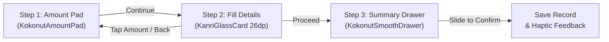

# Entry Workflows & Action Popup Design

**Current Version:** 1.18.12 (Build 63)  
**Last Updated:** 2026-11-11  

---

## 1. Overview
Kanri provides a unified, fluid financial logging workflow for all core entry types:
1. **Expense**: Logging spent money across categories and accounts.
2. **Income**: Recording received money with optional savings goal contribution.
3. **Lend & Borrow**: Personal debt ledger tracking funds lent to or borrowed from contacts.
4. **Split Expense**: Splitting group bills between multiple friends with automatic ledger synchronization.
5. **Instant Payment Detection Popup**: Floating interactive overlay triggered when SMS or UPI payment notifications arrive.

Every entry follows the identical 3-step Apple-grade pop-up workflow:
1. Zero-start Amount Pad (`KokonutAmountPad`)
2. Half-screen Fill Details popup with uniformly arranged fields, Back, Cancel, and Proceed buttons
3. Down-to-up small half-screen summary drawer with rolling numbers and slide-to-confirm slider (`KokonutSmoothDrawer` + `KokonutSlideToConfirm`).

All entry surfaces enforce a fixed 50 dp blur and 10% dark tint via `GlassLevel.EntrySheet`.

---

## 2. Navigation Z-Order Elevation & Floating Dock Behavior
To eliminate any possibility of bottom dialogs appearing behind the bottom floating dock (`KanriFloatingDock`), all modal dialogs are elevated to the root navigation overlay container in `MainNavigationScreen.kt`:

- **Root Z-Order Elevation**: `AddTransactionDialog`, `LendingEntryDialog`, `SplitExpenseEntryDialog`, and `LendingTransactionBridgeDialog` are rendered in the root Box of `MainNavigationScreen.kt`, *above* the tab contents and above `KanriFloatingDock`.
- **Dock Auto-Slide Transition**: When any entry sheet is active (`isAnyEntryModalOpen`), `KanriFloatingDock` smoothly slides down off-screen via `slideOutVertically + fadeOut`. When the sheet is confirmed or dismissed, the dock smoothly slides back into position via `slideInVertically + fadeIn`.
- **Delegated Entry Callbacks**: `LendingScreen` and `HomeScreen` expose `onOpenAddEntry`, `onOpenSplitExpense`, and `onOpenLendBorrowTransaction` callbacks so that all user actions (e.g. "Add Record", "Track Loan", "Edit", "Split a Group Expense", "Bridge from Transaction") trigger the top-level elevated container.
- **Pure In-Compose Architecture**: `SplitExpenseEntryDialog` was converted to a pure in-compose sheet (matching `LendingEntryDialog` and `AddTransactionDialog`), ensuring direct sampling of the backdrop `HazeState` without native dialog window boundary limitations.

---

## 3. Floating Dock Action Popup (`AddExpenseIncomePopup`)
The floating dock '+' button displays a hardware-accelerated frosted glass card (`KanriGlassCard`) elevated directly above the bottom navigation dock.

### Core Options
| Option | Subtitle | Accent Color | Custom Flow Icon | Triggered Dialog |
|---|---|---|---|---|
| **Expense** | Log spent money | Vibrant Red (`#E54D2E`) | `ExpenseFlowIcon` | `AddTransactionDialog(initialType = "DEBIT")` |
| **Income** | Log received money | Sage Green (`#30A46C`) | `IncomeFlowIcon` | `AddTransactionDialog(initialType = "CREDIT")` |

*Note:* Lend & Borrow and Split Bill are initiated from the Lending Hub screen and transaction category flows, keeping the floating dock action popup focused and uncluttered.

### Visual & Interactive Behavior
- **Fluid Spring Animation**: Enters with snappy scale-in (`0.90 -> 1.0f`) and vertical spring translation (`KanriMotion.SmoothSlideSpring`).
- **Glassmorphic Adaptation**: Dynamically consumes `tokens.tintLightness`, border gradients, and elevation shadows matching the current glass theme.
- **Dismissal**: Dismisses on tap outside or upon selecting an entry option.

---

## 4. The 3-Step Unified Pop-up Workflow
Every manual entry is rendered as a bottom-anchored modal popup sheet rather than a centered or full-page dialog.

### Step 1: Zero-Start Amount Pad (`KokonutAmountPad`)
- Large, zero-start fluid keypad.
- Formatted currency display with live rolling digits.
- Clean pull/dismiss drag handle at the top.
- Proceeding advances directly to the Fill Details step with the entered amount preserved.
- Calibrated to `GlassLevel.EntrySheet` (fixed 50 dp blur and 10% dark tint).

### Step 2: Fill Details (`KanriGlassCard`)
- Bottom-docked half-screen card with 26 dp rounded top corners (NO full-screen stretching).
- **Uniform Info Fields Arrangement**:
  - Drag handle and header title/subtitle.
  - **Tappable Amount Card**: Displays the entered amount with an "Edit" affordance; tapping returns to Step 1 without data loss.
  - Role/Type toggle (e.g. "I Lent" vs "I Borrowed").
  - Target/Person Name field with integrated Profile and Contacts pickers, plus quick suggestion chips.
  - Date & Time row (Date chip + Time chip).
  - Expected Return / Due date chips with quick presets and calendar picker.
  - Wallet impact chips ("Cash", "Online", "Not from balances").
  - Contextual Note field.
- **Action Buttons**: "Back" text button on the left, "Cancel" text button and bold "Proceed" primary button on the right.
- Calibrated to `GlassLevel.EntrySheet` (fixed 50 dp blur and 10% dark tint).

### Step 3: Summary Drawer & Slide to Confirm (`KokonutSmoothDrawer`)
- Down-to-up small half-screen summary drawer with detailed breakdown rows.
- Rolling total amount display.
- Semantic confirmation color and label (`SlideConfirmationType.EXPENSE`, `INCOME`, `LEND`, or `BORROW`).
- **`KokonutSlideToConfirm`**: Zero-latency drag gesture with progressive haptic feedback, snap animation, loading spinner, and success checkmark before automatically dismissing the dialog.
- Calibrated to `GlassLevel.EntrySheet` (fixed 50 dp blur and 10% dark tint).

---

## 5. Instant Payment Detection Floating Popup Card (`InstantPopupCard` & `InstantPopupService`)
When an incoming transaction SMS or UPI notification is received, Kanri presents an interactive floating card directly over the screen:

### Visual Architecture & Glassmorphic Optics
- **Android WindowManager Compositor Blur**: On Android 12+ (API 31+), the overlay window enables `FLAG_BLUR_BEHIND` with `blurBehindRadius = 45.dp` in Glass mode.
- **45% Dark Scrim Backdrop**: A full-screen translucent scrim (`Color.Black.copy(alpha = 0.45f)`) dims the underlying screen with coordinated `fadeIn`/`fadeOut` transitions.
- **Translucent Frosted Card Container**: The card is rendered with a 35% dark tint (`#141622` at 0.35 alpha), a vertical white sheen gradient, a 0.8 dp specular gradient border, and an inner 1 dp top specular highlight rim, allowing the hardware-accelerated 45 dp blur of the underlying screen to shine through cleanly with real optical depth.
- **Theme-Adaptive Surface**: Unified across all themes:
  - **Glass Mode**: Hardware-accelerated cross-window blur with translucent specular glass card.
  - **Light Mode**: Pure crisp white elevated surface (`#FFFFFF`) with subtle border and elevation shadow.
  - **Dark Mode**: High-contrast dark charcoal surface (`#161618`) with elevation shadow.
  - **AMOLED Mode**: Deep pure black surface (`#000000`) with high-contrast border.

### Interaction & UX Layout
1. **Top Drag Handle & Natural Drag-Down to Dismiss**:
   - Visual 36×4 dp rounded pill drag handle (`RoundedCornerShape(50)`) in subtle dim grey (`dimGrey.copy(alpha = 0.35f)`) at the top center of the card.
   - **Direct 1:1 Drag-Down Manipulation**: Touch tracking with zero-latency synchronous offset updates.
   - **Rubberband Upward Resistance**: Tactile exponential decay resistance when pulling upward (asymptotically capped at -24 dp) snapping back to 0 with elastic spring bounce.
   - **Dismiss Commit & Fling**: Commits to dismiss when dragged past 90 dp or when flicked downward with velocity > 1000 px/s; springs back to rest if released below threshold.
   - **Directional Disambiguation**: Horizontal gestures (`abs(dx) > abs(dy) * 1.15f`) are gracefully handed off to category pill horizontal scroll and the `KokonutSlideToConfirm` slider without interference or accidental dismissal.
2. **Header**: Clean, centered dim grey date & timestamp (`07 Nov, 05:45 AM`) in `GoogleSansFlex` with an aligned close icon button.
3. **Amount**: Large 40 sp bold currency typography in Vibrant Red (`#E54D2E`) for expense and Sage Green (`#30A46C`) for income.
4. **Merchant & Tag**: Clean merchant name and bank/wallet brand tag.
5. **Left-Aligned Search**: Plain text hyperlink with search icon on the left to quickly expand the search input box.
6. **Dynamic Contextual Category Pills**: Displays dynamically ranked categories in capsule pills (`RoundedCornerShape(50)`). Ranks categories based on historical usage frequency from past transactions and time-of-day contextual relevance (e.g. morning coffee/transit vs midday groceries vs evening dining), placing the smart-resolved category at index 0.
7. **Capsule Notes Prompt**: Pill-shaped notes input box (`RoundedCornerShape(50)`) with clear button.
8. **Primary Slide-to-Confirm Slider (`KokonutSlideToConfirm`)**: Unified 1:1 Apple Fluid Design drag gesture with rubberband resistance, fluid ink trailing layer, dynamic confirming state ("Saving…"), and morphing emerald green success checkmark banner ("Expense saved!" / "Income added!") with tactile haptic pulse and 850ms hold before transitioning to the Current Balance view.
9. **Post-Confirmation "Current Balance" View with Rolling Text Animation & Bracketed Delta**:
   - **Down-to-Up Transition**: Smooth physical slide transition (`slideInVertically` from bottom + `fadeIn` paired with exiting form's `slideOutVertically` upward + `fadeOut` and animated `SizeTransform`) directly inside the card container.
   - **"Current Balance" Header**: Dim grey medium label in `GoogleSansFlex`.
   - **Rolling Text Reel Animation (`RollingText`)**: Ported slot-machine physics using deterministic `mulberry32` PRNG. Each character travels through a vertical reel of rotating digits (`copies = cycles + 1`) decelerating via `expo.out` easing (`CubicBezierEasing(0.16f, 1.0f, 0.3f, 1.0f)`) with individual character duration variance.
   - **Bracketed Delta Amount**: Shows the added/deducted amount right next to the rolling balance: `[Amount with rolling animation](+amount/-amount)` in Sage Green (`#30A46C`) for income and Vibrant Red (`#E54D2E`) for expense.
   - **All Google Sans Font**: Strictly adheres to `GoogleSansFlex` across all numbers, currency symbols, and text.
   - **3-Second Auto-Dismissal**: Automatically dismisses the popup 3 seconds after the balance rolls into place (also dismissible immediately at any moment via natural drag-down).
10. **Split Expense Action**: Direct hyperlink at the bottom ("Split expense ›") opening the split expense flow with pre-filled amount and merchant.

### Coordinated Pop-up & Pop-down Motion
The popup card shares the exact signature spring motion from `AddExpenseIncomePopup`:
- **Pop-up (Entrance)**: `fadeIn(180ms)` + `scaleIn(0.90f, KanriMotion.SnappySpring)` + `slideInVertically(10%, KanriMotion.SmoothSlideSpring)`.
- **Pop-down (Exit)**: `fadeOut(140ms)` + `scaleOut(0.94f)` + `slideOutVertically(8%)`.
- Coordinated through `dismissWithAnimation` across outside dismiss, close button, 3-second post-balance auto-dismissal, and Split expense action.

---

## 6. Modules & Files Involved
- `app/src/main/java/com/omkarnub/kanri/ui/popup/InstantPopupCard.kt`: Themed floating payment detection popup card with down-to-up balance transition and 3-second auto-dismissal.
- `app/src/main/java/com/omkarnub/kanri/ui/common/RollingText.kt`: Jetpack Compose port of GSAP slot-machine rolling digit reel component with `mulberry32` PRNG and `expo.out` easing.
- `app/src/main/java/com/omkarnub/kanri/ui/popup/InstantPopupService.kt`: Overlay service managing `WindowManager.LayoutParams`, cross-window blur, background scrim, live balance resolution, and lifecycle.
- `app/src/main/java/com/omkarnub/kanri/ui/common/kokonut/KokonutSlideToConfirm.kt`: Primary tactile slide-to-confirm slider component with ink flooding, spinner, and emerald green success state.
- `app/src/main/java/com/omkarnub/kanri/ui/settings/SettingsComponents.kt`: Settings screen item for previewing the detection popup.
- `app/src/main/java/com/omkarnub/kanri/ui/common/KanriGlass.kt`: Core glassmorphism tokens, `KanriGlassCard`, and `GlassLevel.EntrySheet`.
- `app/src/main/java/com/omkarnub/kanri/ui/navigation/AddExpenseIncomePopup.kt`: Action popup menu and signature spring motion curves (`KanriMotion`).
- `app/src/main/java/com/omkarnub/kanri/ui/navigation/MainNavigationScreen.kt`: Navigation host wiring floating dock popup and dialog triggers.
