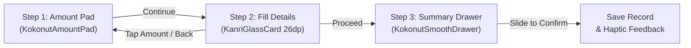

# Entry Workflows & Action Popup Design

**Current Version:** 1.4.5 (Build 16)  
**Last Updated:** 2026-11-05  

---

## 1. Overview
Kanri provides a unified, fluid financial logging workflow for all core entry types:
1. **Expense**: Logging spent money across categories and accounts.
2. **Income**: Recording received money with optional savings goal contribution.
3. **Lend & Borrow**: Personal debt ledger tracking funds lent to or borrowed from contacts.
4. **Split Expense**: Splitting group bills between multiple friends with automatic ledger synchronization.

Every entry follows the identical 3-step Apple-grade pop-up workflow:
1. Zero-start Amount Pad (`KokonutAmountPad`)
2. Half-screen Fill Details popup with uniformly arranged fields, Back, Cancel, and Proceed buttons
3. Down-to-up small half-screen summary drawer with rolling numbers and slide-to-confirm slider (`KokonutSmoothDrawer` + `KokonutSlideToConfirm`).

All entry surfaces enforce a fixed 50 dp blur and 10% dark tint via `GlassLevel.EntrySheet`.

---

## 2. Floating Dock Action Popup (`AddExpenseIncomePopup`)
The floating dock '+' button displays a hardware-accelerated frosted glass card (`KanriGlassCard`) elevated directly above the bottom navigation dock.

### Core Options
| Option | Subtitle | Accent Color | Custom Flow Icon | Triggered Dialog |
|---|---|---|---|---|
| **Expense** | Log spent money | Vibrant Red (`#E54D2E`) | `ExpenseFlowIcon` | `AddTransactionDialog(initialType = "DEBIT")` |
| **Income** | Log received money | Sage Green (`#30A46C`) | `IncomeFlowIcon` | `AddTransactionDialog(initialType = "CREDIT")` |

*Note:* Lend & Borrow and Split Bill are initiated from the Lending Hub screen and transaction category flows, keeping the floating dock action popup focused and uncluttered.

### Visual & Interactive Behavior
- **Fluid Spring Animation**: Enters with snappy scale-in (`0.90 -> 1.0f`) and vertical spring translation (`KanriMotion.SmoothSlideSpring`).
- **Glassmorphic Adaptation**: Dynamically consumes `tokens.tintLightness`, border gradients, and elevation shadows matching the current glass theme.
- **Dismissal**: Dismisses on tap outside or upon selecting an entry option.

---

## 3. The 3-Step Unified Pop-up Workflow
Every manual entry is rendered as a bottom-anchored modal popup sheet rather than a centered or full-page dialog.

### Step 1: Zero-Start Amount Pad (`KokonutAmountPad`)
- Large, zero-start fluid keypad.
- Formatted currency display with live rolling digits.
- Clean pull/dismiss drag handle at the top.
- Proceeding advances directly to the Fill Details step with the entered amount preserved.
- Calibrated to `GlassLevel.EntrySheet` (fixed 50 dp blur and 10% dark tint).

### Step 2: Fill Details (`KanriGlassCard`)
- Bottom-docked half-screen card with 26 dp rounded top corners (NO full-screen stretching).
- **Uniform Info Fields Arrangement**:
  - Drag handle and header title/subtitle.
  - **Tappable Amount Card**: Displays the entered amount with an "Edit" affordance; tapping returns to Step 1 without data loss.
  - Role/Type toggle (e.g. "I Lent" vs "I Borrowed").
  - Target/Person Name field with integrated Profile and Contacts pickers, plus quick suggestion chips.
  - Date & Time row (Date chip + Time chip).
  - Expected Return / Due date chips with quick presets and calendar picker.
  - Wallet impact chips ("Cash", "Online", "Not from balances").
  - Contextual Note field.
- **Action Buttons**: "Back" text button on the left, "Cancel" text button and bold "Proceed" primary button on the right.
- Calibrated to `GlassLevel.EntrySheet` (fixed 50 dp blur and 10% dark tint).

### Step 3: Summary Drawer & Slide to Confirm (`KokonutSmoothDrawer`)
- Down-to-up small half-screen summary drawer with detailed breakdown rows.
- Rolling total amount display.
- Semantic confirmation color and label (`SlideConfirmationType.EXPENSE`, `INCOME`, `LEND`, or `BORROW`).
- **`KokonutSlideToConfirm`**: Zero-latency drag gesture with progressive haptic feedback, snap animation, loading spinner, and success checkmark before automatically dismissing the dialog.
- Calibrated to `GlassLevel.EntrySheet` (fixed 50 dp blur and 10% dark tint).

---

## 4. Fixed 50dp Blur & 10% Dark Tint Specification
All entry workflows enforce a standardized visual glass hierarchy via `GlassLevel.EntrySheet`:
- **Blur Radius**: Fixed at `50.dp`.
- **Tint**: Fixed at 10% dark tint (`Color.Black.copy(alpha = 0.10f)`).
- **Surface**: Supported across both custom glass themes (using hardware `hazeEffect`) and solid Material themes (with dark scrim and frosted fallbacks).

---

## 5. Modules & Files Involved
- `app/src/main/java/com/omkarnub/kanri/ui/common/KanriGlass.kt`: `GlassLevel.EntrySheet` implementation with fixed 50 dp blur and 10% dark tint.
- `app/src/main/java/com/omkarnub/kanri/ui/navigation/AddExpenseIncomePopup.kt`: Clean 2-option floating action popup menu ("Expense" and "Income").
- `app/src/main/java/com/omkarnub/kanri/ui/navigation/MainNavigationScreen.kt`: Navigation host wiring floating dock popup and dialog triggers.
- `app/src/main/java/com/omkarnub/kanri/ui/home/AddTransactionDialog.kt`: Unified 3-step half-screen dialog for Expense and Income.
- `app/src/main/java/com/omkarnub/kanri/ui/lending/LendingEntryDialog.kt`: Unified 3-step half-screen bottom popup dialog for Lend & Borrow records with Proceed button and Kokonut drawer.
- `app/src/main/java/com/omkarnub/kanri/ui/lending/SplitExpenseEntryDialog.kt`: Unified 3-step half-screen bottom popup dialog for splitting group bills with Proceed button and Kokonut drawer.
- `app/src/main/java/com/omkarnub/kanri/ui/common/kokonut/KokonutAmountPad.kt`: Standardized zero-start amount pad with `GlassLevel.EntrySheet`.
- `app/src/main/java/com/omkarnub/kanri/ui/common/kokonut/KokonutSmoothDrawer.kt`: Standardized summary drawer with `GlassLevel.EntrySheet` and slide-to-confirm slider.
- `app/src/main/java/com/omkarnub/kanri/ui/lending/LendingScreen.kt`: Lend & Borrow hub entry points with full screen overlay and haze support.
