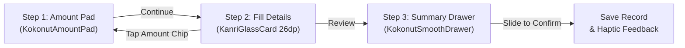

# Entry Workflows & Action Popup Design

**Current Version:** 1.4.4 (Build 15)  
**Last Updated:** 2026-11-04  

---

## 1. Overview
Kanri provides a unified, fluid financial logging workflow for all four core entry types:
1. **Expense**: Logging spent money across categories and accounts.
2. **Income**: Recording received money with optional savings goal contribution.
3. **Lend & Borrow**: Personal debt ledger tracking funds lent to or borrowed from contacts.
4. **Split Expense**: Splitting group bills between multiple friends with automatic ledger synchronization.

All entry flows are accessible directly from the dock's floating action menu (`AddExpenseIncomePopup`), and every entry follows the identical 3-step Apple-grade pop-up workflow.

---

## 2. Floating Dock Action Popup (`AddExpenseIncomePopup`)
The floating dock '+' button displays a hardware-accelerated frosted glass card (`KanriGlassCard`) elevated directly above the bottom navigation dock.

### 4 Core Options
| Option | Subtitle | Accent Color | Custom Flow Icon | Triggered Dialog |
|---|---|---|---|---|
| **Expense** | Log spent money | Vibrant Red (`#E54D2E`) | `ExpenseFlowIcon` | `AddTransactionDialog(initialType = "DEBIT")` |
| **Income** | Log received money | Sage Green (`#30A46C`) | `IncomeFlowIcon` | `AddTransactionDialog(initialType = "CREDIT")` |
| **Lend & Borrow** | Lent or borrowed money | Indigo / Violet (`#6366F1`) | `LendBorrowFlowIcon` | `LendingEntryDialog()` |
| **Split Expense** | Split a bill with friends | Amber / Tangerine (`#F59E0B`) | `SplitBillFlowIcon` | `SplitExpenseEntryDialog()` |

### Visual & Interactive Behavior
- **Fluid Spring Animation**: Enters with snappy scale-in (`0.90 -> 1.0f`) and vertical spring translation (`KanriMotion.SmoothSlideSpring`).
- **Glassmorphic Adaptation**: Dynamically consumes `tokens.tintLightness`, border gradients, and elevation shadows matching the current glass theme.
- **Dismissal**: Dismisses on tap outside or upon selecting any entry option.

---

## 3. The 3-Step Unified Pop-up Workflow
Every manual entry is rendered as a bottom-anchored modal popup sheet rather than a centered or full-page dialog.

### Step 1: Zero-Start Amount Pad (`KokonutAmountPad`)
- Large, zero-start fluid keypad.
- Formatted currency display with live rolling digits.
- Clean pull/dismiss drag handle at the top.
- Proceeding advances directly to the Fill Details step with the entered amount preserved.

### Step 2: Fill Details (`KanriGlassCard`)
- Bottom-docked card with 26 dp rounded top corners.
- **Tappable Amount Chip**: Displays the entered amount with an "Edit" affordance; tapping returns to Step 1 without data loss.
- **Contextual Fields**:
  - *Expense/Income*: Category selector, payment source, wallet impact (Cash/Online/None), date & time picker, note, and optional savings goal allocation.
  - *Lend/Borrow*: "I Lent" vs "I Borrowed" toggle, contact picker, due date presets, wallet impact, and notes.
  - *Split Expense*: "I Paid" vs "Friend Paid" toggle, event description, people counter stepper (2–20 people), dynamic per-person share display, and friend name assignment chips.
- **Review Button**: Validates inputs and triggers the smooth drawer transition.

### Step 3: Summary Drawer & Slide to Confirm (`KokonutSmoothDrawer`)
- Pull-up confirmation drawer with detailed breakdown rows.
- Semantic confirmation color and label (`SlideConfirmationType.EXPENSE`, `INCOME`, `LEND`, or `BORROW`).
- **`KokonutSlideToConfirm`**: Zero-latency drag gesture with progressive haptic feedback, snap animation, loading spinner, and success checkmark before automatically dismissing the dialog.

---

## 4. Modules & Files Involved
- `app/src/main/java/com/omkarnub/kanri/ui/navigation/AddExpenseIncomePopup.kt`: Floating action popup menu with 4 options and custom SVG icons (`ExpenseFlowIcon`, `IncomeFlowIcon`, `LendBorrowFlowIcon`, `SplitBillFlowIcon`).
- `app/src/main/java/com/omkarnub/kanri/ui/navigation/MainNavigationScreen.kt`: Navigation host wiring the dock popup to each dialog workflow.
- `app/src/main/java/com/omkarnub/kanri/ui/home/AddTransactionDialog.kt`: Unified 3-step dialog for Expense and Income.
- `app/src/main/java/com/omkarnub/kanri/ui/lending/LendingEntryDialog.kt`: Unified 3-step bottom popup dialog for Lend & Borrow records.
- `app/src/main/java/com/omkarnub/kanri/ui/lending/SplitExpenseEntryDialog.kt`: Unified 3-step bottom popup dialog for splitting group bills.
- `app/src/main/java/com/omkarnub/kanri/ui/lending/SplitExpenseSheet.kt`: Backwards-compatible delegate wrapper.
- `app/src/main/java/com/omkarnub/kanri/ui/lending/SplitRole.kt`: Shared role enum (`I_PAID` vs `SOMEONE_ELSE`).
- `app/src/main/java/com/omkarnub/kanri/ui/lending/LendingScreen.kt`: Lend & Borrow hub entry points.
